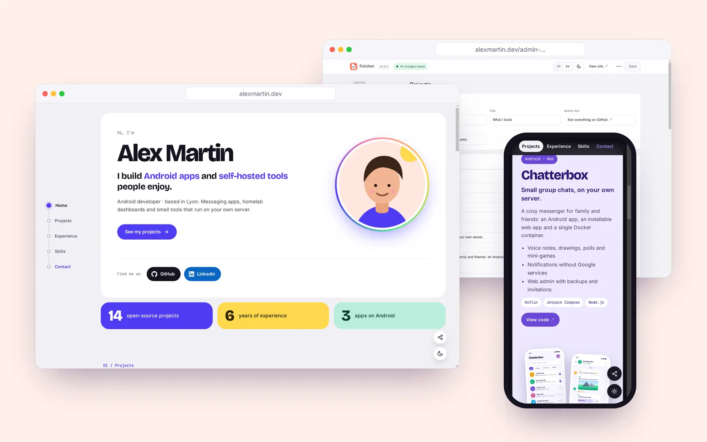
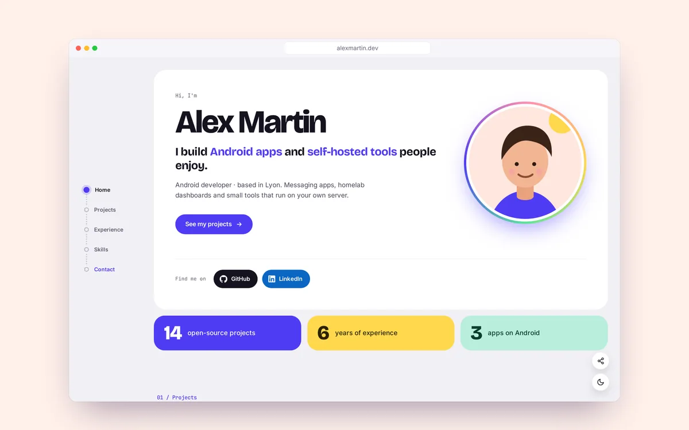
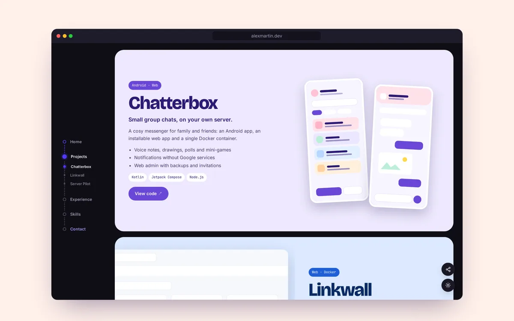
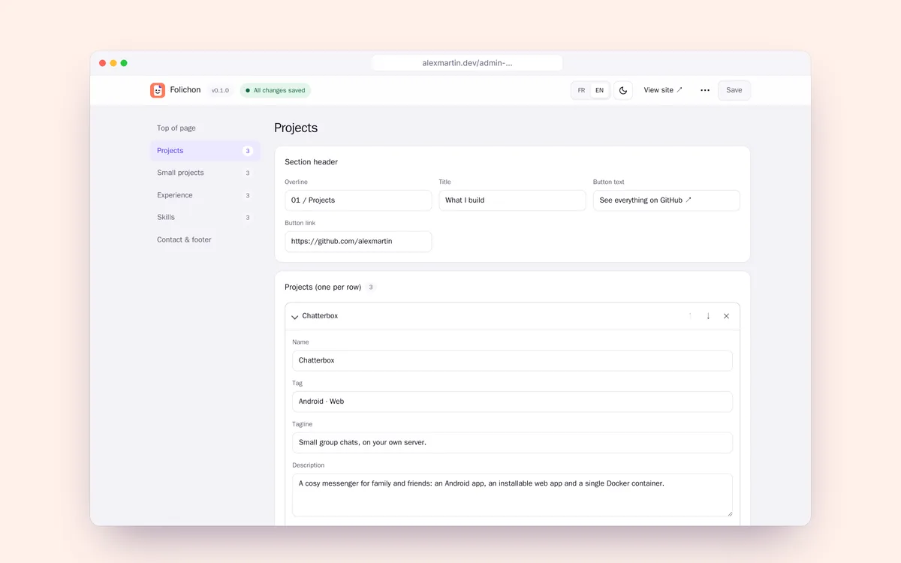
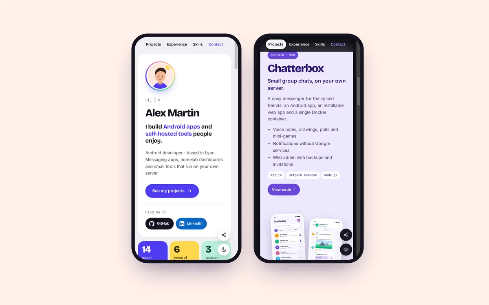

<p align="center">
  
</p>

<h1 align="center">Folichon</h1>

<p align="center">
  <b>Ton CV et tes projets, sur ton propre serveur.</b><br>
  Une page portfolio joyeuse que tu modifies depuis ton navigateur : un seul conteneur Docker, sans base de données.
</p>

<p align="center">
  <a href="https://github.com/MrDDream/Folichon/releases/latest"></a>
  <a href="https://github.com/MrDDream/Folichon/pkgs/container/folichon"></a>
  <a href="https://github.com/MrDDream/Folichon/actions/workflows/tests.yml"></a>
  <a href="LICENSE"></a>
</p>

<p align="center">
  <a href="#installation-docker-compose">Installer</a> ·
  <a href="#-ce-que-ça-fait">Fonctions</a> ·
  <a href="#-captures">Captures</a> ·
  <a href="README.md">English</a>
</p>

<p align="center">
  
</p>

---

## 😄 Pourquoi Folichon ?

Un CV en PDF, c'est bien, mais ça ne montre pas ce que tu construis. Les créateurs de sites le montrent joliment, sur leurs serveurs, avec leur logo et leurs traceurs.

Folichon, c'est une seule page qui raconte ton histoire (qui tu es, ce que tu construis, ton parcours, tes compétences), hébergée sur **ton** serveur. Tu la modifies depuis un éditeur intégré, dans ton navigateur : pas de code, pas de recompilation, pas de base de données.

## ✨ Ce que ça fait

|                                  |                                                                                                                                                                                                             |
| -------------------------------- | ----------------------------------------------------------------------------------------------------------------------------------------------------------------------------------------------------------- |
| 🧑‍💻 **Une page qui te ressemble** | Présentation avec photo, chiffres clés, grands projets avec leurs couleurs et leurs captures, mini projets, parcours, compétences et contact.                                                               |
| ✏️ **Éditeur intégré**           | Tous les textes, liens, couleurs et images se modifient dans le navigateur, avec des listes réordonnables, l'annulation d'une suppression et une protection contre l'écrasement d'une version plus récente. |
| 🔐 **Sécurisé**                  | Administration à une adresse secrète, mot de passe **et** double authentification, essais limités, sessions révocables, en-têtes de sécurité stricts.                                                       |
| 🌗 **Clair et sombre**           | Suit le système, avec un bouton sur la page et dans l'éditeur.                                                                                                                                              |
| 🎨 **7 thèmes, tes polices**     | Folichon, Magazine, Terminal, Rétro, Néon, Pop ou CV sobre : chacun change la mise en page, pas seulement les couleurs. Une police pour les titres et le texte, ou la tienne en fichier.                    |
| 📱 **Pensé mobile**              | Menu collant, mise en page compacte, menu de partage du téléphone.                                                                                                                                          |
| 🌍 **Français et anglais**       | La page et l'éditeur parlent les deux.                                                                                                                                                                      |
| 🪶 **Léger**                     | Un seul conteneur, pas de base de données, aucune ressource externe : polices servies par le site, images en WebP.                                                                                          |

## 📸 Captures

<table>
<tr>
<td align="center"><b>Page publique</b><br></td>
<td align="center"><b>Mode sombre</b><br></td>
</tr>
<tr>
<td align="center"><b>Éditeur</b><br></td>
<td align="center"><b>Sur mobile</b><br></td>
</tr>
</table>

## Installation (Docker Compose)

1. Crée un dossier avec ce `docker-compose.yml` :

   ```yaml
   services:
     folichon:
       image: ghcr.io/mrddream/folichon:latest
       container_name: folichon
       restart: unless-stopped
       init: true
       ports:
         - '3000:3000'
       env_file: .env
       volumes:
         - ./data:/data
   ```

2. À côté, un fichier `.env` lisible par toi seul (`chmod 600 .env`) :

   ```bash
   # Mot de passe de l'administration : 12 caractères ou plus conseillés
   ADMIN_PASSWORD=
   # Adresse secrète de l'administration, par exemple /gestion-7f3k9q2x
   ADMIN_PATH=
   # Derrière un reverse proxy (Nginx Proxy Manager, Traefik, Caddy…) :
   # TRUST_PROXY=loopback, uniquelocal
   # SITE_URL=https://exemple.fr
   ```

3. Crée le dossier des données (le conteneur tourne avec l'utilisateur `1000`) puis démarre :

   ```bash
   mkdir -p data && sudo chown 1000:1000 data
   docker compose up -d
   ```

Le site est sur `http://ton-serveur:3000`, l'administration sur `http://ton-serveur:3000/gestion-7f3k9q2x`. Sans `ADMIN_PATH`, une adresse aléatoire est générée : elle s'affiche dans `docker logs folichon`.

Pour construire l'image toi-même : clone le dépôt, `cp .env.example .env`, puis `docker compose up -d --build`.

## Variables d'environnement

| Variable         | Rôle                                                                                                                                                           | Par défaut                                    |
| ---------------- | -------------------------------------------------------------------------------------------------------------------------------------------------------------- | --------------------------------------------- |
| `ADMIN_PASSWORD` | Mot de passe de l'admin. Sans lui (ou trop court), l'admin est désactivée.                                                                                     | —                                             |
| `ADMIN_PATH`     | Adresse secrète de l'admin.                                                                                                                                    | aléatoire, gardée dans `data/admin-path.txt`  |
| `TRUST_PROXY`    | Derrière un reverse proxy : proxys à croire pour l'IP des visiteurs, par exemple `loopback, uniquelocal` ou `1`. `true` est refusé (IP falsifiables).          | désactivé                                     |
| `SITE_URL`       | Adresse publique du site, pour les aperçus de partage (WhatsApp, LinkedIn…).                                                                                   | déduite de la requête                         |
| `UPDATE_CHECK`   | Vérifie sur GitHub (au plus toutes les 12 h) si une version plus récente de Folichon existe, affichée à côté de la version dans l'admin. `false` la désactive. | activée                                       |
| `SESSION_SECRET` | Clé de signature des sessions.                                                                                                                                 | aléatoire, gardée dans `data/.session-secret` |
| `PORT`           | Port d'écoute dans le conteneur.                                                                                                                               | `3000`                                        |
| `DATA_DIR`       | Dossier des données.                                                                                                                                           | `/data` dans Docker                           |

## Double authentification

- **Première connexion** : après le mot de passe, un QR code s'affiche. Scanne-le avec ton application et entre le code pour l'activer. La clé est gardée dans `data/totp.json`.
- **Connexions suivantes** : mot de passe, puis le code du moment.
- **Téléphone perdu ou changé** : supprime `data/totp.json` puis redémarre le conteneur. Un nouveau QR code sera proposé.

## Utiliser l'administration

- Toutes les sections sont éditables : présentation, photo, CV, réseaux, chiffres, grands projets, mini projets, parcours, compétences, contact et pied de page.
- **Listes** : ajoute, supprime et réordonne les éléments avec les flèches ↑ ↓.
- **Images** : bouton « Envoyer une image » ou un lien `https://…`.
- **Couleurs** : chaque grand projet a son propre jeu de couleurs.
- **Thème et polices** (Haut de page › Réglages du site) : 7 thèmes qui changent la mise en page et le style de la page publique ; le mode clair/sombre et la couleur d'accent restent les tiens. Une police pour les titres, une pour le texte : une fournie (Bricolage Grotesque, Inter, JetBrains Mono), une famille déjà installée sur les appareils (serif, arrondie, manuscrite…) ou ton propre fichier (WOFF2, WOFF, TTF ou OTF), servi par ton serveur. Vérifie que sa licence autorise l'usage sur un site.
- **Accroche** : les mots entre astérisques prennent la couleur d'accent, par exemple `Je fabrique des *apps Android*`.
- **Enregistrer** (ou Ctrl/Cmd + S) : la page publique est à jour immédiatement ; la version précédente est gardée dans `data/content.backup.json`. Si le contenu a changé ailleurs (autre onglet), l'enregistrement est refusé au lieu de l'écraser.
- **Exporter / Importer** : sauvegarde ou restaure tout le contenu en un fichier JSON.
- Un lien, une photo ou un e-mail laissé vide masque le bouton correspondant. L'adresse e-mail n'apparaît jamais en clair dans la page.

## Sécurité

- Mot de passe **et** code TOTP à 6 chiffres (un code ne sert qu'une fois).
- 5 essais ratés maximum par IP, et 30 au total, toutes les 15 minutes.
- Sessions signées, `HttpOnly`, `SameSite=Strict`, valables 12 h ; changer le mot de passe ou la clé 2FA déconnecte tout le monde, et « Déconnexion » révoque la session côté serveur.
- Requêtes d'écriture refusées si elles viennent d'un autre site.
- En-têtes `Content-Security-Policy`, `Permissions-Policy`, `Cross-Origin-Opener-Policy`, `X-Content-Type-Options`, `Strict-Transport-Security` (en HTTPS), `noindex` sur l'admin.
- Envois limités aux images (PNG, JPG, WebP, GIF, AVIF) et au PDF, 15 Mo maximum, avec vérification du contenu réel. Pas de SVG.
- Aucune ressource externe chargée par la page.

Une faille ? Voir [SECURITY.md](SECURITY.md).

## Développement

```bash
npm install
ADMIN_PASSWORD=motdepasse-de-test ADMIN_PATH=/admin npm run dev
npm run check     # Prettier, ESLint et tests
```

## Licence

[MIT](LICENSE). Les polices (Inter, Bricolage Grotesque, JetBrains Mono) sont sous licence SIL Open Font License : voir `public/fonts/`.
