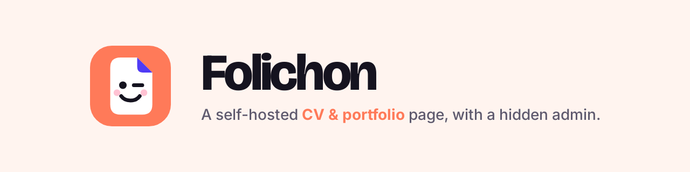
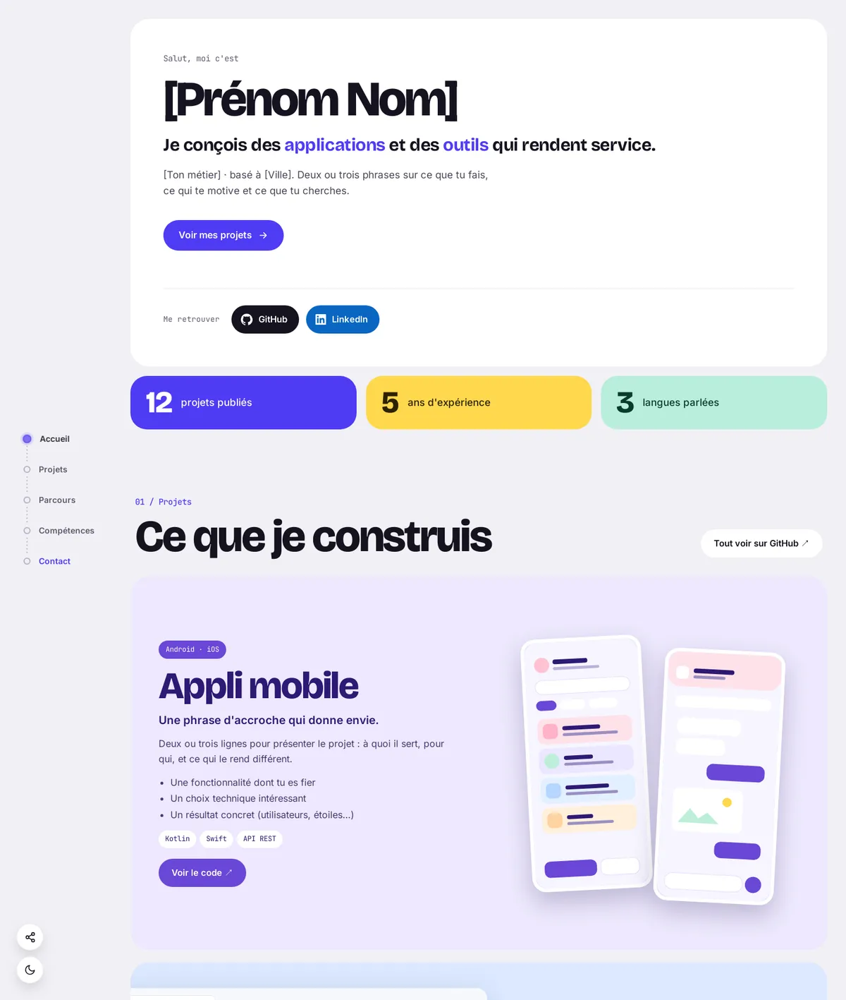

<p align="center"></p>

<p align="center">
<a href="#install-docker-compose">Install</a> ·
<a href="#using-the-admin">Admin</a> ·
<a href="#security">Security</a> ·
<a href="README.fr.md">Français</a>
</p>

**Folichon** is a self-hosted CV / portfolio page with a **hidden admin** to edit everything without touching the code: introduction, projects, experience, skills, contact.

<p align="center"></p>

- Server-rendered public page, mobile friendly, with **dark mode** and a **share menu**.
- Admin at a **secret address**, protected by a password **and two-factor authentication** (Google Authenticator, Aegis, 2FAS…).
- All content lives in one JSON file; images and the CV uploaded from the admin are stored next to it.
- **A single Docker container**, no database, no external service (fonts included).

The sample content and the admin are in French; every text on the page can be changed from the admin.

## Install (Docker Compose)

1. Create a folder with this `docker-compose.yml`:

   ```yaml
   services:
     folichon:
       image: ghcr.io/mrddream/folichon:latest
       container_name: folichon
       restart: unless-stopped
       init: true
       ports:
         - '3000:3000'
       env_file: .env
       volumes:
         - ./data:/data
   ```

2. Next to it, a `.env` file only you can read (`chmod 600 .env`):

   ```bash
   # Admin password: 12 characters or more recommended
   ADMIN_PASSWORD=
   # Secret admin address, for example /admin-7f3k9q2x
   ADMIN_PATH=
   # Behind a reverse proxy (Nginx Proxy Manager, Traefik, Caddy…):
   # TRUST_PROXY=loopback, uniquelocal
   # SITE_URL=https://example.com
   ```

3. Create the data folder (the container runs as user `1000`) and start:

   ```bash
   mkdir -p data && sudo chown 1000:1000 data
   docker compose up -d
   ```

The site is at `http://your-server:3000`, the admin at `http://your-server:3000/admin-7f3k9q2x`. Without `ADMIN_PATH`, a random address is generated and printed in `docker logs folichon`.

To build the image yourself: clone the repository, `cp .env.example .env`, then `docker compose up -d --build`.

## Environment variables

| Variable         | Purpose                                                                                                                                   | Default                                |
| ---------------- | ----------------------------------------------------------------------------------------------------------------------------------------- | -------------------------------------- |
| `ADMIN_PASSWORD` | Admin password. Without it (or if too short), the admin is disabled.                                                                      | —                                      |
| `ADMIN_PATH`     | Secret admin address.                                                                                                                     | random, kept in `data/admin-path.txt`  |
| `TRUST_PROXY`    | Behind a reverse proxy: proxies trusted for the visitor IP, for example `loopback, uniquelocal` or `1`. `true` is refused (IP spoofing).  | off                                    |
| `SITE_URL`       | Public address of the site, used for share previews (WhatsApp, LinkedIn…).                                                                | taken from the request                 |
| `UPDATE_CHECK`   | Checks GitHub (at most every 12 h) whether a newer Folichon version exists, shown next to the version in the admin. `false` turns it off. | on                                     |
| `SESSION_SECRET` | Session signing key.                                                                                                                      | random, kept in `data/.session-secret` |
| `PORT`           | Port inside the container.                                                                                                                | `3000`                                 |
| `DATA_DIR`       | Data folder.                                                                                                                              | `/data` in Docker                      |

## Two-factor authentication

- **First sign-in**: after the password, a QR code is shown. Scan it with your authenticator app and enter the code to turn it on. The key is kept in `data/totp.json`.
- **Next sign-ins**: password, then the current code.
- **Lost or new phone**: delete `data/totp.json` and restart the container. A new QR code is offered.

## Using the admin

- Every section can be edited: introduction, photo, CV, social links, key figures, projects, small projects, experience, skills, contact and footer.
- **Lists**: add, remove and reorder items with the ↑ ↓ arrows.
- **Images**: "Envoyer une image" button, or an `https://…` link.
- **Colours**: each project has its own colour set.
- **Headline**: words between asterisks take the accent colour, for example `I build *Android apps*`.
- **Save** (or Ctrl/Cmd + S): the public page updates at once; the previous version is kept in `data/content.backup.json`. If the content changed elsewhere (another tab), saving is refused instead of overwriting it.
- **Export / Import**: back up or restore all content as one JSON file.
- An empty link, photo or e-mail hides the matching button. The e-mail address never appears in clear in the page.

## Security

- Password **and** 6-digit TOTP code (each code works only once).
- At most 5 failed attempts per IP, and 30 in total, every 15 minutes.
- Signed, `HttpOnly`, `SameSite=Strict` sessions valid for 12 h; changing the password or the 2FA key signs everyone out, and "Déconnexion" revokes the session on the server.
- Write requests coming from another site are refused.
- `Content-Security-Policy`, `Permissions-Policy`, `Cross-Origin-Opener-Policy`, `X-Content-Type-Options`, `Strict-Transport-Security` (over HTTPS) headers, `noindex` on the admin.
- Uploads limited to images (PNG, JPG, WebP, GIF, AVIF) and PDF, 15 MB at most, with a check of the real content. No SVG.
- The page loads no external resource.

Found a vulnerability? See [SECURITY.md](SECURITY.md).

## Development

```bash
npm install
ADMIN_PASSWORD=test-password ADMIN_PATH=/admin npm run dev
npm run check     # Prettier, ESLint and tests
```

## License

[MIT](LICENSE). The fonts (Inter, Bricolage Grotesque, JetBrains Mono) are under the SIL Open Font License: see `public/fonts/`.
